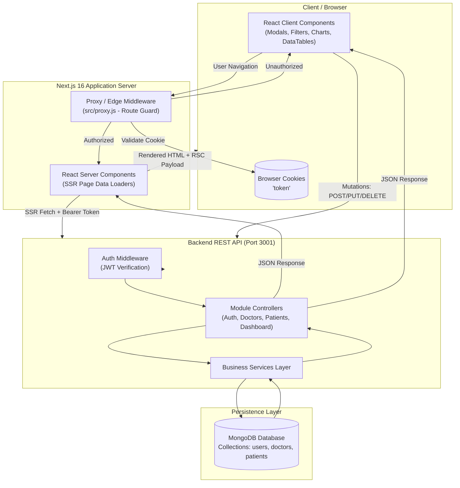

# Doctor Tracker - Clinical Operations & Patient Management Portal

## Elevator Pitch

**Doctor Tracker** is a full-stack clinical operations and patient caseload management platform designed to streamline healthcare administration across hospital departments. By uniting real-time clinician caseload monitoring, granular patient registry workflows, and dynamic operational analytics within a responsive, secure interface, Doctor Tracker eliminates communication bottlenecks between administrative staff and medical professionals—empowering clinical leaders to balance doctor workload distribution, track patient admissions across specialties, and deliver timely, high-quality patient care.

---

## Step-by-Step Local Installation

### Prerequisites

- **Node.js**: v18.17.0 or higher (v20+ recommended)
- **Package Manager**: `npm` (comes with Node.js), `yarn`, or `pnpm`
- **MongoDB**: A running MongoDB instance locally or a cloud database via [MongoDB Atlas](https://www.mongodb.com/atlas)
- **Git**

---

### 1. Clone the Repository

```bash
git clone <repository-url>
cd "Doctor panel"
```

---

### 2. Backend Server Setup

1. Navigate to the server directory:

   ```bash
   cd server
   ```

2. Install dependencies:

   ```bash
   npm install
   ```

3. Configure environment variables by creating a `.env` file:

   ```bash
   touch .env
   ```

   Add the following configuration:

   ```env
   PORT=3001
   MONGODB_URI=mongodb://localhost:27017/doctor_panel
   JWT_SECRET=your_super_secret_jwt_key_here
   JWT_EXPIRES_IN=7d
   ```

4. Start the Express backend server:

   ```bash
   # Development mode (with nodemon)
   npm run dev

   # Or standard production start
   npm start
   ```

   The backend API will be available at `http://localhost:3001`.

---

### 3. Frontend Client Setup

1. Open a new terminal and navigate to the Next.js client directory:

   ```bash
   cd client/doctor-tracker
   ```

2. Install dependencies:

   ```bash
   npm install
   ```

3. Create your local environment configuration using the provided `.env.example`:

   ```bash
   cp .env.example .env.local
   ```

4. Verify your `.env.local` contents:

   ```env
   # Backend API Base URL
   NEXT_PUBLIC_API_URL=http://localhost:3001
   API_URL=http://localhost:3001

   # Authentication Cookie Name
   AUTH_COOKIE_NAME=token
   ```

5. Run the frontend development server:

   ```bash
   npm run dev
   ```

6. Open [http://localhost:3000](http://localhost:3000) in your browser.

---

## High-Level Data Flow & Service Interactions

The application follows a modern decoupled architecture separating presentation logic, server-side data fetching, and persistence layers.



### Data Flow Lifecycle

1. **Authentication & Session Routing**:
   - The user submits login credentials from the client.
   - The Express server validates password hashes via `bcryptjs`, signs a JSON Web Token (`JWT`), and returns the payload.
   - The client stores the JWT in an HTTP-accessible cookie (`token`).
   - On every incoming request, Next.js's `proxy.js` intercepts traffic: unauthenticated users accessing `/dashboard`, `/doctors`, or `/patients` are redirected to `/login`, while authenticated users visiting `/login` or `/register` are redirected to `/dashboard`.

2. **Server-Side Data Rendering (SSR & Suspense)**:
   - For `/dashboard`, `/doctors`, `/doctors/[id]`, and `/patients`, Next.js Server Components extract the session cookie server-side via `cookies()` and execute parallel queries (`Promise.all`) directly against the Express backend.
   - Streaming Suspense boundaries (`DashboardSkeleton`, `DoctorsSkeleton`, `PatientsSkeleton`) display instant layout skeletons while server queries resolve.

3. **Client Interactions & Revalidation**:
   - Filter inputs, search bars, and pagination update URL search parameters via Next.js router transitions.
   - Modal operations (adding a clinician, registering a patient, updating doctor affiliations) invoke the centralized API client (`@/lib/api-client`).
   - Following successful mutations, the UI triggers `router.refresh()` to immediately revalidate server data without requiring full page reloads.

---

## Application Showcase & Screenshots

### Desktop Views

#### Hospital Operations Dashboard
Real-time operational dashboard with metrics, caseload distribution, specialization breakdown, and registration velocity:


#### Doctors Directory & Caseload Management
Full doctor table with specialization badges, hospital affiliations, patient counts, and action buttons:


---

### Mobile Responsive Views

| Patients Management (Mobile) | Doctors Directory (Mobile) |
| :---: | :---: |
|  |  |

---

## Deep Dive: Key Architectural Decisions

### 1. URL-Driven State & React Server Components vs. Global Client State Management (Why We Chose URL State over Redux / Context API)

#### The Problem
In clinical workflows (like the Doctor Directory and Patient Registry shown above), doctors and administrative staff constantly filter records by:
- Attending doctor & hospital affiliations
- Clinical triage condition (`Critical`, `Serious`, `Stable`, `Discharged`)
- Gender, blood group, and registration date ranges
- Paginated record browsing

In many traditional React apps, developers reach for **Redux Toolkit** or **React Context API** to manage these filters. However, this creates severe problems in a medical administration portal:
1. **Lost State on Reload & No Shareability**: Redux state lives only in client memory. If an administrator applies 4 filters, finds a critical patient, and sends the browser URL to a colleague—or simply reloads the page—all filter state is lost.
2. **Client Bundle Bloat**: Redux adds 35–50 KB of minified JavaScript (store, slices, reducers, dispatchers, action creators) just to synchronize temporary filter controls.
3. **Hydration Waterfalls & Render Lag**: Client state forces components to mount, read the store, and trigger client-side `fetch()` requests, displaying jarring loading spinners on every filter change.

#### Why We Chose URL-Driven State + React Server Components
Instead of Redux or Context API, we treat the **Browser URL Query String** (`?gender=Female&condition=Critical&page=2`) as the **Single Source of Truth**:
- **0 KB Store Overhead**: Native browser query strings require zero client state libraries.
- **Deep Linking & Bookmarking**: Medical staff can copy the exact URL or bookmark a filtered view and share it directly with doctors.
- **Instant Server Rendering (SSR)**: Next.js Server Components receive search parameters directly via `page.js` props, query the backend Express API with Bearer tokens server-to-server, and stream pre-rendered HTML within `Suspense` skeletons.

#### Comparison Matrix

| Architectural Criterion | URL-Driven State + Server Components (Our Choice) | Global Client State (Redux / Context API) |
| :--- | :--- | :--- |
| **Client JS Footprint** | **0 KB** (built-in URL primitives) | **35–50 KB** (Redux, slices, reducers) |
| **State Sharing & Bookmarking** | **Native** (exact filters and pages live in URL) | **Requires manual sync** (lost on refresh by default) |
| **Initial Paint (FCP)** | **Fast** (HTML pre-rendered on server with data) | **Slow** (blank layout $\rightarrow$ client fetch on mount) |
| **Complexity & Maintenance** | **Minimal** (`useSearchParams` & `router.replace`) | **High** (actions, reducers, store configuration) |

---

### 2. Cookie-Based JWT Auth with Edge Proxy Route Guards vs. Client-Only LocalStorage Auth

#### The Problem
A healthcare portal manages sensitive clinical data. Unauthorized users must never see patient records or hospital metrics.

In standard React SPAs, authentication tokens are saved in browser `localStorage`. However, client-only `localStorage` authentication has critical vulnerabilities and performance flaws in modern server-rendered architectures:
1. **Flash of Unauthenticated Content (FOUC)**: With `localStorage`, the browser must download the protected page, mount the React application, execute a `useEffect` hook to read `localStorage.getItem('token')`, and only then trigger a redirect. Users experience a jarring flash of protected UI or blank screens before being redirected.
2. **Incompatibility with Server Components (SSR)**: React Server Components execute on the server where `window.localStorage` does not exist. Server Components cannot access the token to make authenticated queries to the backend during SSR.
3. **Cross-Site Scripting (XSS) Vulnerability**: Tokens stored in `localStorage` can be stolen by any script injected via third-party dependencies.

#### Why We Chose Cookie-Based Sessions + Edge Proxy Route Guards
We implemented HTTP cookie session tokens (`token`) combined with Next.js Edge Proxy Middleware (`src/proxy.js`):
- **Edge-Level Route Interception (Zero FOUC)**: Next.js `proxy.js` intercepts incoming HTTP requests *before* HTML generation starts. An unauthenticated request to `/dashboard`, `/doctors`, or `/patients` receives an immediate HTTP `307 Redirect` to `/login?callbackUrl=...`. Unauthorized users never receive a single byte of protected UI.
- **Isomorphic Server-Side Fetching**: Because cookies are automatically included in HTTP request headers, Server Components access the session token directly using `cookies()` from `next/headers` and forward it as `Authorization: Bearer <token>` directly to the Express REST API.
- **Clean Session Lifecycle**: Logging out cleanly clears the cookie across both client and server contexts without residual orphaned storage.

#### Comparison Matrix

| Security & Runtime Criterion | Cookie Sessions + Edge Proxy (Our Choice) | Client LocalStorage Auth |
| :--- | :--- | :--- |
| **Route Protection Timing** | **At the Edge / Server** before HTML generation | **On Client Mount** inside `useEffect` hook |
| **User Experience** | **Instant 307 Redirect** (Zero layout flash / FOUC) | **Flashes loading spinner** before redirecting |
| **Server Component (SSR) Support** | **Full** (Token accessible via `cookies()` in SSR) | **Impossible** (`window.localStorage` unavailable on server) |
| **Token Exposure** | **Scoped HTTP Cookie** | **Accessible to any script** reading `localStorage` |
