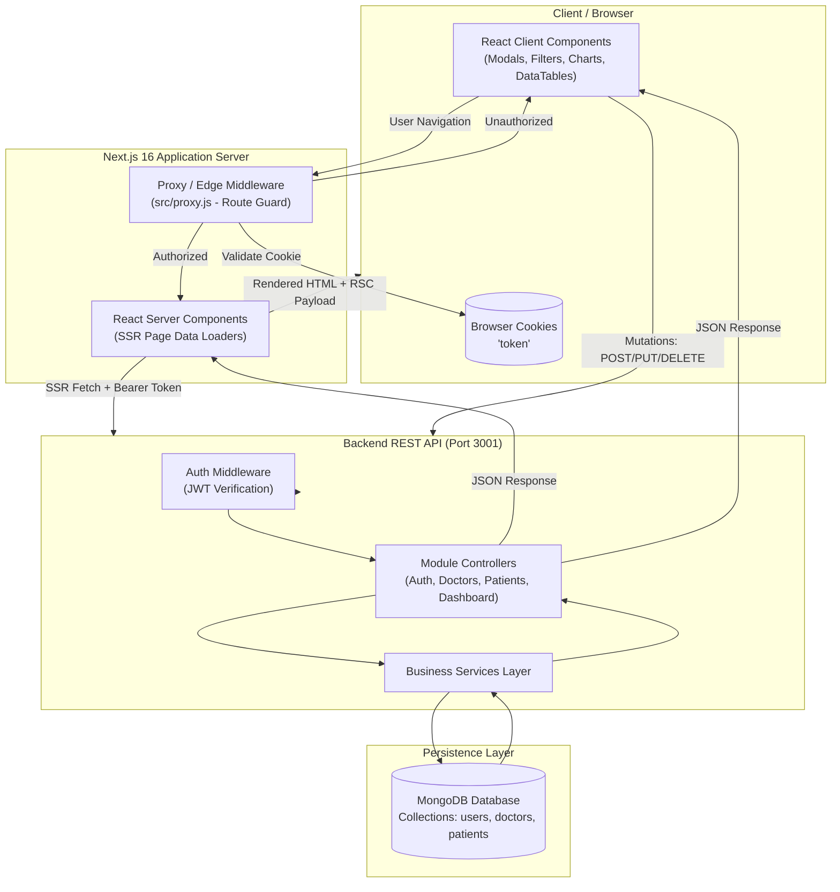
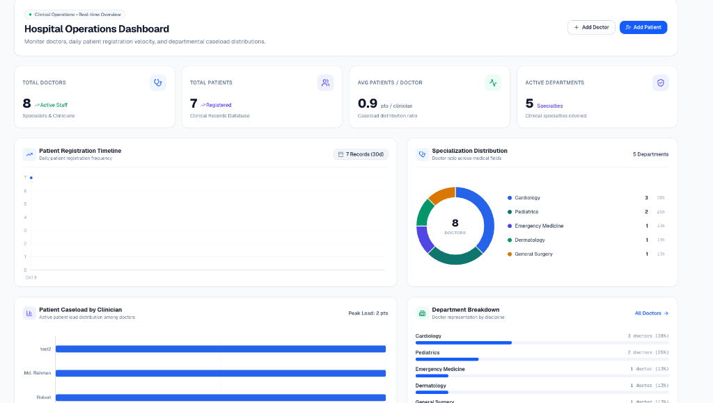
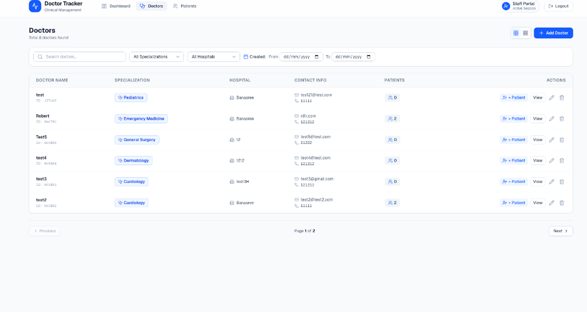
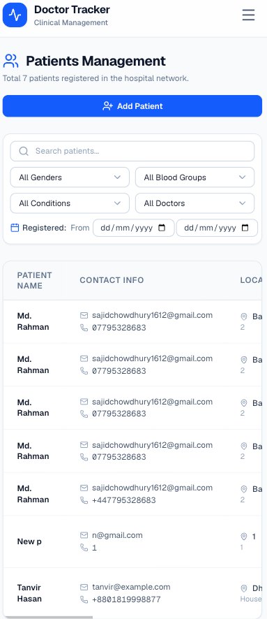
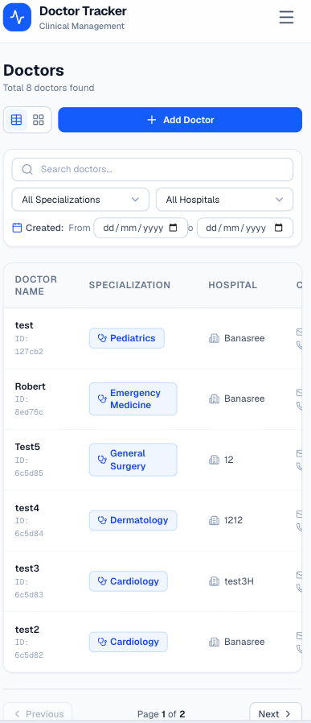

# Doctor Tracker - Clinical Operations & Patient Management Portal

## Elevator Pitch

**Doctor Tracker** is a full-stack clinical operations and patient caseload management platform designed to streamline healthcare administration across hospital departments. By uniting real-time clinician caseload monitoring, granular patient registry workflows, and dynamic operational analytics within a responsive, secure interface, Doctor Tracker eliminates communication bottlenecks between administrative staff and medical professionals—empowering clinical leaders to balance doctor workload distribution, track patient admissions across specialties, and deliver timely, high-quality patient care.

---

## Step-by-Step Local Installation

### Prerequisites

- **Node.js**: v18.17.0 or higher (v20+ recommended)
- **Package Manager**: `npm` (comes with Node.js), `yarn`, or `pnpm`
- **MongoDB**: A running MongoDB instance locally or a cloud database via [MongoDB Atlas](https://www.mongodb.com/atlas)
- **Git**

---

### 1. Clone the Repository

```bash
git clone <repository-url>
cd "Doctor panel"
```

---

### 2. Backend Server Setup

1. Navigate to the server directory:

   ```bash
   cd server
   ```

2. Install dependencies:

   ```bash
   npm install
   ```

3. Configure environment variables by creating a `.env` file:

   ```bash
   touch .env
   ```

   Add the following configuration:

   ```env
   PORT=3001
   MONGODB_URI=mongodb://localhost:27017/doctor_panel
   JWT_SECRET=your_super_secret_jwt_key_here
   JWT_EXPIRES_IN=7d
   ```

4. Start the Express backend server:

   ```bash
   # Development mode (with nodemon)
   npm run dev

   # Or standard production start
   npm start
   ```

   The backend API will be available at `http://localhost:3001`.

---

### 3. Frontend Client Setup

1. Open a new terminal and navigate to the Next.js client directory:

   ```bash
   cd client/doctor-tracker
   ```

2. Install dependencies:

   ```bash
   npm install
   ```

3. Create your local environment configuration using the provided `.env.example`:

   ```bash
   cp .env.example .env.local
   ```

4. Verify your `.env.local` contents:

   ```env
   # Backend API Base URL
   NEXT_PUBLIC_API_URL=http://localhost:3001
   API_URL=http://localhost:3001

   # Authentication Cookie Name
   AUTH_COOKIE_NAME=token
   ```

5. Run the frontend development server:

   ```bash
   npm run dev
   ```

6. Open [http://localhost:3000](http://localhost:3000) in your browser.

---

## High-Level Data Flow & Service Interactions

The application follows a modern decoupled architecture separating presentation logic, server-side data fetching, and persistence layers.



### Data Flow Lifecycle

1. **Authentication & Session Routing**:
   - The user submits login credentials from the client.
   - The Express server validates password hashes via `bcryptjs`, signs a JSON Web Token (`JWT`), and returns the payload.
   - The client stores the JWT in an HTTP-accessible cookie (`token`).
   - On every incoming request, Next.js's `proxy.js` intercepts traffic: unauthenticated users accessing `/dashboard`, `/doctors`, or `/patients` are redirected to `/login`, while authenticated users visiting `/login` or `/register` are redirected to `/dashboard`.

2. **Server-Side Data Rendering (SSR & Suspense)**:
   - For `/dashboard`, `/doctors`, `/doctors/[id]`, and `/patients`, Next.js Server Components extract the session cookie server-side via `cookies()` and execute parallel queries (`Promise.all`) directly against the Express backend.
   - Streaming Suspense boundaries (`DashboardSkeleton`, `DoctorsSkeleton`, `PatientsSkeleton`) display instant layout skeletons while server queries resolve.

3. **Client Interactions & Revalidation**:
   - Filter inputs, search bars, and pagination update URL search parameters via Next.js router transitions.
   - Modal operations (adding a clinician, registering a patient, updating doctor affiliations) invoke the centralized API client (`@/lib/api-client`).
   - Following successful mutations, the UI triggers `router.refresh()` to immediately revalidate server data without requiring full page reloads.

---

## Application Showcase & Screenshots

### Desktop Views

#### Hospital Operations Dashboard

Real-time operational dashboard with metrics, caseload distribution, specialization breakdown, and registration velocity:


#### Doctors Directory & Caseload Management

Full doctor table with specialization badges, hospital affiliations, patient counts, and action buttons:


---

### Mobile Responsive Views

|                 Patients Management (Mobile)                 |                 Doctors Directory (Mobile)                 |
| :----------------------------------------------------------: | :--------------------------------------------------------: |
|  |  |

---
